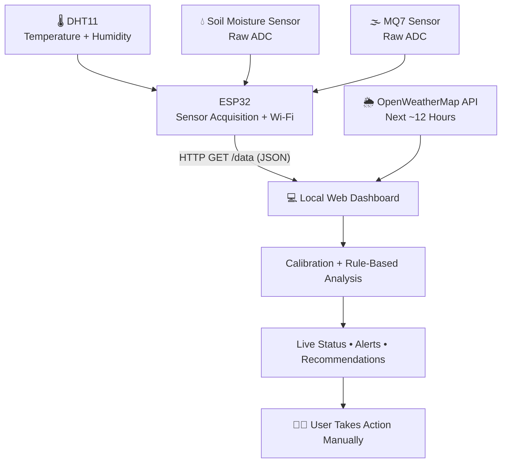

<div align="center">

# 🌱 Smart Agriculture Monitoring & Decision Support System

### Real-time field monitoring • ESP32 + Wi-Fi • Weather-aware recommendations


**Don Bosco Institute of Technology, Mumbai**  
**Department of Information Technology | Semester VII | A.Y. 2026–2027**

*A working Internet of Everything (IOE) prototype that turns live sensor readings and short-term weather forecasts into useful agricultural recommendations.*

</div>

---

## 🌿 Project Overview

Conventional agricultural monitoring often depends on manual checks of soil and environmental conditions. This project offers a **browser-based, real-time monitoring system** using an **ESP32** and three sensor modules.

It measures temperature, humidity, indicative soil moisture and raw gas-sensor levels. A custom dashboard displays the readings, shows short trends, and suggests actions based on configurable thresholds and an OpenWeatherMap forecast.

> [!IMPORTANT]
> **This is a monitoring and decision-support project, not an automatic irrigation system.** There is **no pump, relay, valve, or fan control**. The user decides whether to act on each recommendation.

## ✨ Key Features

| | Feature | Description |
|:--:|---|---|
| 🌡️ | **Live environmental monitoring** | Temperature and humidity from DHT11 |
| 💧 | **Soil moisture estimation** | Relative percentage from adjustable dry/wet calibration |
| 🌫️ | **Gas-level indicator** | Raw MQ7 ADC readings with warning limits |
| 📡 | **ESP32 Wi-Fi server** | Local HTTP endpoint returning JSON at `/data` |
| 📊 | **Interactive dashboard** | Animated gauges, sensor cards and recent trend lines |
| 🌦️ | **Weather integration** | OpenWeatherMap forecast for the selected city |
| 🧠 | **Smart recommendations** | Irrigation, rain, waterlogging, heat and ventilation advice |
| ⚙️ | **Custom settings** | Adjustable thresholds, calibration and refresh interval |

## 🧩 System Architecture



**IOE pillars:** **Things** (sensors + ESP32) · **Data** (measurements + forecast) · **Process** (threshold checks) · **People** (farmer/operator).

## 🔩 Hardware & Pin Connections

| Component | ESP32 connection | Purpose |
|---|---|---|
| DHT11 DATA | `GPIO 4` | Digital temperature/humidity |
| Soil moisture sensor AO | `GPIO 34` | Analog moisture reading |
| MQ7 sensor AO | `GPIO 35` | Analog gas-level reading |
| Sensor VCC | `3.3V` | Power used in our working prototype |
| Sensor GND | `GND` | Common ground |

**Other items:** ESP32 development board, breadboard, jumper wires, USB cable, Wi-Fi connection and laptop/mobile browser.

> [!CAUTION]
> ESP32 GPIO pins are **not 5 V tolerant**. Check the output voltage of each sensor module before connecting it. The MQ7 values here are **uncalibrated raw ADC measurements**, **not CO concentration in ppm**, and must not be used as a certified safety alarm.

## 📂 Project Structure

```text
Smart-Agriculture-IOE/
│
├── esp32_web_server.ino          # ESP32 Arduino firmware
├── smart_agri_dashboard_v2.html  # Browser dashboard
└── README.md                     # Project guide
```

## 🚀 Setup & Installation

### 1️⃣ Prepare Arduino IDE

1. Install the **Arduino IDE**.
2. Install the **ESP32 board package** from **Boards Manager**.
3. From **Library Manager**, install:
   - **DHT sensor library** by Adafruit
   - **Adafruit Unified Sensor**
4. The `WiFi.h` and `WebServer.h` libraries come with the ESP32 board package.

### 2️⃣ Configure & Upload the Firmware

Open `esp32_web_server.ino`, then replace the Wi-Fi values with your own:

```cpp
const char* WIFI_SSID = "YOUR_WIFI_NAME";
const char* WIFI_PASS = "YOUR_WIFI_PASSWORD";
```

Select the correct ESP32 board and COM port, then click **Upload**.

Open the **Serial Monitor at 115200 baud** to view the device's IP address.

> The weather API constants in the Arduino sketch are not used by the current firmware. Weather requests are made by the **browser dashboard**, where the user enters the API key.

### 3️⃣ Verify ESP32 Data

On a device that can reach your ESP32 through the local network, open:

```text
http://YOUR_ESP32_IP/data
```

Example response (**illustrative values**):

```json
{
  "temperature": 29.5,
  "humidity": 65.2,
  "soil": 2700,
  "gas": 850,
  "dhtOk": true
}
```

| JSON field | Meaning |
|---|---|
| `temperature` | Temperature in °C |
| `humidity` | Relative humidity in % |
| `soil` | Soil moisture sensor raw ADC value |
| `gas` | MQ7 raw ADC value |
| `dhtOk` | Whether the latest DHT11 read succeeded |

### 4️⃣ Launch the Dashboard

1. Open `smart_agri_dashboard_v2.html` **locally in your browser**.
2. Type the ESP32 IP address in the top bar.
3. Click **Connect**.
4. Check the live readings, trends and **What to do now** recommendations.
5. Open **Settings, calibration and limits** to adjust thresholds.

✅ **No Blynk, Firebase, MQTT or cloud database is required.** The dashboard and ESP32 communicate directly over local Wi-Fi.

### 5️⃣ Enable Weather Forecasts

Inside the dashboard settings:

- Enter your **city** (default: Mumbai).
- Enter a working **OpenWeatherMap API key**.
- Connect the dashboard and view the forecast panel.

The dashboard requests four forecast entries, representing approximately the **next 12 hours**, and refreshes weather data approximately every **30 minutes**.

> [!NOTE]
> The forecast needs internet access. The current dashboard saves settings, including the API key, in the browser's `localStorage`, so do not use private credentials on a shared computer.

## 🧠 Decision-Support Logic

The dashboard evaluates readings with **configurable, rule-based thresholds**:

| Condition | Default value | Recommendation |
|---|---:|---|
| Dry soil | Moisture **< 30%** | 💧 Irrigate |
| Dry soil + likely rain | Forecast rain probability **≥ 60%** | 🌧️ Wait / suppress irrigation |
| Excess moisture | Moisture **> 85%** | 🚫 Hold irrigation |
| High temperature | **≥ 32°C** | 🌡️ Heat-stress watch |
| Critical temperature | **≥ 38°C** | 🔥 Heat-stress alert |
| Elevated raw MQ7 value | **≥ 1500 ADC** | 🌬️ Ventilation warning |
| Critical raw MQ7 value | **≥ 2500 ADC** | ⚠️ Stronger ventilation alert |
| Hot and humid conditions | Humidity **> 85%** and temperature **> 30°C** | 🌿 Heat/humidity advisory when no gas warning takes precedence |

These are **prototype defaults**, not crop-specific recommendations or calibrated gas-safety limits. The project uses **JavaScript decision rules, not machine learning**.

## 💧 Soil Moisture Calibration

The dashboard converts the sensor's raw analog reading to an estimated moisture percentage:

```text
Moisture (%) = ((Dry reading − Current reading) / (Dry reading − Wet reading)) × 100
```

Default calibration values:

- **Dry reading:** `3200`
- **Wet reading:** `1400`

Example: With raw soil reading `2700`, the dashboard estimates **27.8%** moisture.

The result is limited to **0–100%**. Replace the defaults with real sensor measurements from your setup. **Do not set dry and wet calibration readings equal.**

> Soil percentage is an **indicative relative value**, not a laboratory measurement of volumetric water content.

## ⏱️ Update Intervals

| Task | Current behavior |
|---|---|
| ESP32 sensor readings | Approximately every **2 seconds** |
| Analog sensor filtering | Average of **10 samples** |
| Dashboard polling | Every **3 seconds** by default |
| Weather refresh | About every **30 minutes** |
| Trend display | Last **30 measurements** in browser memory |

## 🛠️ Troubleshooting

<details>
<summary><b>ESP32 is not connecting to Wi-Fi</b></summary>

Check the SSID, password, 2.4 GHz Wi-Fi availability, power supply and messages in Serial Monitor.

</details>

<details>
<summary><b>Dashboard says ESP32 is unreachable</b></summary>

Confirm the IP from Serial Monitor, ensure the browser device can reach the ESP32, and try opening `http://YOUR_ESP32_IP/data` directly.

</details>

<details>
<summary><b>Temperature or humidity is missing</b></summary>

Check DHT11 wiring, power and GPIO4. The endpoint reports unsuccessful DHT11 reads with `dhtOk: false`.

</details>

<details>
<summary><b>Soil moisture percentage looks incorrect</b></summary>

Recheck the dry/wet calibration values and the analog connection on GPIO34.

</details>

<details>
<summary><b>Weather data does not appear</b></summary>

Verify the OpenWeatherMap key, city spelling and browser internet connection.

</details>

### Known Limitations

- Monitoring is available only to browsers that can reach the ESP32 on the local network.
- No automatic irrigation or other actuator control.
- No persistent historical database; trend lines store only recent data in memory.
- Gas values are raw and are **not calibrated CO ppm**.
- A disconnected device may leave the last sensor values visible; check the connection indicator.
- Previous forecast data may remain in the recommendation logic after a weather request fails.

## 🔮 Future Improvements

- More robust sensor validation, calibration and stale-data handling
- More durable capacitive soil moisture sensing
- Secure remote monitoring and authentication
- Persistent sensor history and analytics
- Improved weather-data freshness and credential management

**These are possible extensions; they are not features of the current project.**

## 👥 Project Team

| Roll No. | Name | Contribution |
|:---:|---|:---:|
| 07 | Harshal Bhosale | 25% |
| 13 | Rakesh Chaudhary | 25% |
| 15 | Pranit Chiman | 25% |
| 73 | Om Darekar | 25% |

**Project Guide:** Prof. Janhavi Baikerikar  
**Subject:** Internet of Everything (IOE)  
**Institute:** Don Bosco Institute of Technology, Kurla, Mumbai

---

<div align="center">

### 🌾 Monitor Smarter. Decide Better. Farm Responsibly.

**Made for an academic Internet of Everything project.**

</div>
